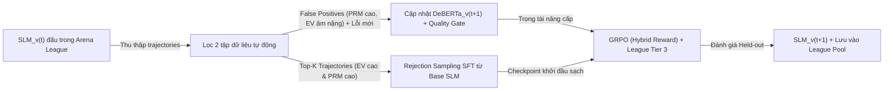

# Kế hoạch Chi tiết — Phase 4: Vòng lặp GRPO, Co-evolution, Ablation Study & Demo (Exp 2–5)

> **Thời lượng dự kiến:** Tuần 5–6+  
> **Tài liệu gốc:** [PROJECT_IDEA.md](./PROJECT_IDEA.md)  
> **Giai đoạn trước:** [Phase 3 — Huấn luyện DeBERTa-v3 Leak Finder](./PHASE_3_DEBERTA_PRM.md)

---

## 1. Mục tiêu & Phạm vi (Goals & Scope)

Phase 4 hợp nhất toàn bộ các mảnh ghép từ Phase 1–3 thành **vòng lặp huấn luyện tự tiến hóa (Self-Evolving Gym)**, chạy đủ bảng thí nghiệm đối chứng khoa học (**Exp 2 → Exp 5**) để chứng minh định lượng đóng góp của từng thành phần, mở rộng sang **Tháp đối thủ Tầng 3 (GTO + League Play)** và hoàn thiện màn demo **"David vs. Goliath"**.

### Đầu ra bắt buộc của Phase 4
1. **Hybrid Reward Aggregator** chống Reward Hacking (tích hợp $R_{\text{EV}}$, $R_{\text{DeBERTa}}$, $R_{\text{format}}$ và cảnh báo lệch pha PRM–EV).
2. Pipeline **GRPO Training** (`TRL GRPOTrainer` + `vLLM`) đã kiểm thông trên **Leduc Poker** và chạy chính thức trên **HU-NLHE**.
3. Đầy đủ kết quả & biểu đồ đối chứng cho 6 phiên bản **`Exp 0` → `Exp 5`** trên cùng **Held-out Evaluation Suite**.
4. Hệ thống **Adversarial Co-evolution** (Vòng lặp Gen 1 → Gen 2 → Gen 3: tự động khai thác *False Positives* cập nhật `DeBERTa v2/v3` + **Rejection Sampling Fine-Tuning (RFT)** chống *Model Collapse*).
5. **Tầng 3 Arena League:** GTO/CFR Bot (`OpenSpiel` / Solver-approximated Bot) + League đối kháng các phiên bản SLM quá khứ (`SLM_v1`, `SLM_v2`...).
6. **Showmatch "David vs. Goliath"** (500–1.000 ván Duplicate Deals với một LLM lớn chưa chuyên hóa) + Dashboard/Báo cáo trực quan hóa chuỗi 5 bước và bảng điểm DeBERTa từng bước.

---

## 2. Cấu trúc Module Bổ sung trong Repo

```text
pocket-r1/
├── configs/
│   ├── rl/
│   │   ├── grpo_leduc_sanity.yaml
│   │   ├── exp2_grpo_outcome.yaml
│   │   ├── exp3_grpo_ev.yaml
│   │   ├── exp4_grpo_hybrid.yaml
│   │   └── exp5_coevolution.yaml
│   └── league/
│       └── arena_tier3.yaml
├── src/pocket_r1/
│   ├── rewards/
│   │   ├── format_reward.py        # R_format: XML tags, legal action, length penalty
│   │   ├── ev_reward.py            # R_EV: chuẩn hóa Action EV / EV Regret
│   │   ├── prm_reward.py           # R_DeBERTa: min(p_k) / geometric mean
│   │   └── hybrid_aggregator.py    # Tổng hợp R_total + logging phát hiện Reward Hacking
│   ├── training/
│   │   ├── grpo_trainer.py         # Vòng GRPO với TRL + vLLM + Online Gym Prompts
│   │   ├── rft_sampler.py          # Rejection Sampling lọc trajectory top (EV + PRM)
│   │   └── coevolution_loop.py     # Điều phối Gen t -> t+1 (SLM + DeBERTa + League)
│   ├── agents/
│   │   ├── gto_bot.py              # OpenSpiel CFR (Leduc) & Equity/GTO-approx Bot (NLHE)
│   │   └── league_manager.py       # Quản lý hồ đối thủ (4 Bot + GTO + SLM_v1..vt) theo PFSP
│   └── demo/
│       ├── showmatch.py            # Trận đấu đối kháng SLM vs Large LLM (Duplicate Deals)
│       └── visualizer.py           # Xuất báo cáo HTML/Streamlit xem 5 bước + heatmap PRM
├── scripts/
│   ├── run_ablation_exp2_to_exp4.py
│   ├── run_coevolution_exp5.py
│   ├── run_david_vs_goliath.py
│   └── generate_final_report.py
└── reports/
    ├── ablation_summary.md
    ├── coevolution_curves/
    └── showmatch_report.html
```

---

## 3. Thiết kế Kỹ thuật Chi tiết

### 3.1. Hàm Hybrid Reward Chống Reward Hacking (`src/pocket_r1/rewards/`)

Áp dụng công thức cốt lõi từ [PROJECT_IDEA.md](./PROJECT_IDEA.md):

$$
R_{\text{total}} = \alpha \cdot R_{\text{EV}} + \beta \cdot R_{\text{DeBERTa}} + \gamma \cdot R_{\text{format}}
$$

(Khuyến nghị khởi điểm: $\alpha = 0.6$, $\beta = 0.3$, $\gamma = 0.1$; đồng bộ tất cả thành phần về cùng dải `[-1.0, +1.0]` hoặc `[0.0, 1.0]` để trọng số có ý nghĩa thực tế).

#### Chi tiết chuẩn hóa từng thành phần
1. **$R_{\text{format}} \in [-1.0, +1.0]$ (`format_reward.py`):**
   * Đúng cấu trúc 5 `<step>` + 1 `<action>` hợp lệ trong `legal_actions`: `+1.0`.
   * Sai format nhẹ (dư text ngoài thẻ nhưng vẫn parse được action hợp lệ): `+0.2`.
   * Thiếu bước hoặc chọn **Illegal Action**: `-1.0` (**Hard Gate:** khi vi phạm nặng, ép luôn $R_{\text{EV}} = -1.0$ và $R_{\text{DeBERTa}} = 0.0$ để model không bao giờ nhận điểm PRM nếu xuất action bất hợp lệ).
   * **Length Penalty (bảo vệ DeBERTa context):** Nếu `response_tokens > 550`, trừ tuyến tính đến `-0.5` tại `800` tokens để SLM luôn viết cô đọng.
2. **$R_{\text{EV}} \in [-1.0, +1.0]$ (`ev_reward.py`):**
   * **Thiết kế quan trọng (EV Advantage / Regret):** Thay vì dùng thẳng `EV(a)` thô (vì cầm `AA` đánh tệ vẫn có EV dương, còn cầm `72o` Fold chuẩn chỉ có EV = 0), dùng **Relative Action EV** so với hành động tốt nhất tại trạng thái đó:
     $$\Delta \text{EV}(s, a) = \text{EV}(s, a) - \max_{a' \in \mathcal{A}(s)} \text{EV}(s, a') \le 0$$
     hoặc chuẩn hóa mượt quanh trung bình nhóm hành động hợp lệ:
     $$R_{\text{EV}} = \tanh\left(\frac{\text{EV}(s, a) - \overline{\text{EV}}(s)}{\sigma_{\text{scale}}}\right)$$
     (với $\sigma_{\text{scale}} \approx \max(2.0\text{ BB}, 0.5 \times \text{Pot})$).
   * **Lợi ích cực lớn cho GRPO:** Giúp cả tình huống bài yếu (`72o` biết `FOLD` đúng) lẫn bài mạnh (`AA` biết `VALUE BET` đúng) đều nhận được tín hiệu thưởng rõ ràng, không bị nhiễu do độ mạnh ngẫu nhiên của lá bài chia ra!
3. **$R_{\text{DeBERTa}} \in [0.0, 1.0]$ (`prm_reward.py`):**
   * Mặc định dùng **Trung bình nhân** $\left(\prod_{k=1}^6 p_k\right)^{1/6}$ ở đầu RL (mượt gradient) hoặc **Min-pooling** $\min_k p_k$ (nghiêm khắc, chỉ cần 1 bước lỗi là kéo cả chuỗi xuống) — cấu hình thành hyperparameter để so sánh.
   * **Anti-Hacking Gate:** Chỉ cộng đầy đủ phần thưởng $R_{\text{DeBERTa}}$ khi $R_{\text{format}} > 0$ và hành động không gây thảm họa EV ($\Delta \text{EV} > -5\text{ BB}$). Nếu $\Delta \text{EV} \le -5\text{ BB}$, nhân giảm hệ số PRM còn `0.25x` để dập tắt ngay động cơ "viết hay để lừa trọng tài nhưng đánh All-in tự sát".

#### Cảm biến Phát hiện Reward Hacking (W&B Logging)
Trong mọi bước RL, log liên tục 4 chỉ số sống còn:
* `corr(R_EV, R_DeBERTa)`: nếu hệ số tương quan giảm mạnh qua các step → dấu hiệu SLM đang tìm được kẽ hở của DeBERTa!
* `false_positive_rate`: tỷ lệ mẫu có $R_{\text{DeBERTa}} > 0.80$ nhưng $\Delta \text{EV} < -3.0\text{ BB}$.
* `response_length_mean` & `entropy`: cảnh báo sớm hiện tượng suy luận lan man hoặc *Entropy Collapse*.

---

### 3.2. Thiết kế Huấn luyện GRPO (`src/pocket_r1/training/grpo_trainer.py`)

* **Tại sao GRPO lý tưởng ở đây:** Không cần mạng Critic lớn ngang SLM (tiết kiệm ~50% VRAM), tính Advantage tương đối trong nhóm $G$ chuỗi suy luận sinh ra từ cùng 1 trạng thái bàn $s$:
  $$A_i = \frac{R_i - \text{mean}(R_{1..G})}{\text{std}(R_{1..G}) + \epsilon}$$
* **Quy trình kiểm thông bắt buộc trên Leduc Poker trước:**
  * Chạy nhanh `grpo_leduc_sanity.yaml` (1–2 giờ) để xác nhận `vLLM` + `GRPOTrainer` + `DeBERTa Scorer` + `EVCalculator` phối hợp trơn tru, reward tăng đều và `BB/100` tăng trước khi đổ compute vào HU-NLHE.
* **Cấu hình GRPO cho HU-NLHE:**
  * Khởi tạo từ checkpoint tốt nhất của Phase 2 (`Exp 1`).
  * `num_generations (G)`: `8` (hoặc `16` nếu VRAM cho phép).
  * `temperature`: `0.85` (đủ đa dạng để nhóm $G$ có các chiến thuật/hành động khác nhau).
  * `kl_coef (beta)`: `0.02 – 0.04` (neo giữ văn phong và tránh sụp đổ phân phối khỏi SFT).
  * `learning_rate`: `5e-6` – `1e-5` (LoRA) với cosine decay.
  * **Prompt Sampling Pool:** Lấy mẫu trạng thái thực tế từ các trận đấu của SLM hiện tại trong Gym (cập nhật định kỳ mỗi 100–200 RL steps — *on-policy refresh* — để trạng thái phản ánh đúng chiến thuật mới của SLM).

---

### 3.3. Bảng Thí nghiệm Đối chứng (Ablation Study: Exp 2 → Exp 4)

Tất cả các thí nghiệm chạy từ **cùng 1 checkpoint `Exp 1`**, cùng tập prompt curriculum, cùng tổng số RL steps và đánh giá trên **cùng `hu_nlhe_heldout_v1.jsonl`**:

| Thí nghiệm | Hàm Reward bật | Mục tiêu khoa học cần chứng minh |
| :--- | :--- | :--- |
| **Exp 2 (RL Outcome)** | $0.9 \cdot R_{\text{hand\_outcome}} + 0.1 \cdot R_{\text{format}}$ (chỉ thưởng/phạt theo tiền thắng thua thực tế của 1 ván bài) | Cho thấy đường học dao động dữ dội do **High Variance / Bad Beat**, hội tụ kém và dễ sinh lối đánh cầu may. |
| **Exp 3 (+ EV Reward)** | $0.9 \cdot R_{\text{EV}} + 0.1 \cdot R_{\text{format}}$ | Chứng minh **EV Reward** triệt tiêu phương sai may rủi, giúp đường học mượt và `BB/100` tăng vượt trội so với Exp 2. |
| **Exp 4 (+ DeBERTa PRM)** | $0.6 \cdot R_{\text{EV}} + 0.3 \cdot R_{\text{DeBERTa}} + 0.1 \cdot R_{\text{format}}$ | Chứng minh **DeBERTa-v3 Step PRM** giúp giảm mạnh *Card Hallucination*, tăng *Pot Odds Accuracy* & *Logic–Action Consistency*, đồng thời tăng tốc độ hội tụ nhờ tín hiệu thưởng dày đặc (*dense process signal*). |

---

### 3.4. Vòng lặp Đồng tiến hóa & League Play (`Exp 5`, Thế hệ $t \to t+1$)

Sau khi `Exp 4` hoàn tất (tạo ra `SLM_v1` và đã có `DeBERTa_v1`), kích hoạt vòng lặp **Adversarial Co-evolution** cho 2–3 thế hệ (`Gen 1` → `Gen 2` → `Gen 3`):



#### Các cơ chế kỹ thuật then chốt trong `Exp 5`
1. **Nâng cấp Trọng tài (`DeBERTa_v(t+1)`):**
   * Thu thập các mẫu **False Positives** của thế hệ $t$ (DeBERTa chấm $> 0.75$ nhưng $\Delta \text{EV} < -3.0\text{ BB}$ hoặc trượt `StepVerifier`) và **False Negatives** (đánh nước hay $\Delta \text{EV} \approx 0$ hợp logic nhưng DeBERTa phạt oan).
   * Trộn dữ liệu mới với **Replay Buffer** (50% dữ liệu chuẩn từ `PRM v1`) để finetune lên `DeBERTa_v(t+1)` mà không quên lỗi sơ đẳng.
   * Bắt buộc vượt qua **Quality Gate** (`AUC-ROC` trên tập lỗi mới $\ge 0.85$ và không tụt quá `0.02` trên `val_onpolicy_real_v1`).
2. **Rejection Sampling Fine-Tuning (RFT) chống Model Collapse:**
   * Lọc các chuỗi suy luận xuất sắc nhất (Pass Verifier + `R_DeBERTa` cao + `EV` tối ưu) bổ sung vào tập tinh tuyển cộng dồn.
   * **Train lại RFT từ Base SLM gốc** (trộn kèm một phần dữ liệu chuẩn Phase 2 + FIM) trước khi chạy GRPO thế hệ mới → tránh hiện tượng suy thoái phân phối (*Model/Entropy Collapse*) khi lặp SFT mù quáng lên chính mình.
3. **Tháp đối thủ Tầng 3 (`gto_bot.py` & `league_manager.py`):**
   * **GTO / CFR Bot:**
     * Trên `Leduc Poker`: dùng thuật toán **CFR / CFR+** từ `OpenSpiel` cho nghiệm Nash cân bằng chuẩn.
     * Trên `HU-NLHE`: dùng Bot xấp xỉ GTO (dựa trên bảng Pre-flop GTO range + Post-flop Equity/MDF — *Minimum Defense Frequency* + cân bằng tỷ lệ Value/Bluff theo kích cỡ cược) hoặc tích hợp solver nhẹ nếu có.
   * **League Pool & PFSP (Prioritized Fictitious Self-Play):**
     * Lưu snapshot các phiên bản quá khứ (`SLM_v1`, `SLM_v2`...) cùng 4 Bot Tầng 2 và GTO Bot vào một hồ đối thủ.
     * Phân bổ xác suất gặp đối thủ tỷ lệ nghịch với tỷ lệ thắng hiện tại của SLM (ưu tiên đấu nhiều hơn với đối thủ đang làm SLM thua nhiều nhất), đảm bảo SLM vừa tiến hóa trước đối thủ mạnh vừa không quên cách khai thác đối thủ cũ.

---

### 3.5. Kịch bản Demo "David vs. Goliath" & Báo cáo Cuối cùng

* **Thiết lập trận Showmatch (`showmatch.py`):**
  * **David:** `Pocket-R1` (`SLM_v3` cỡ `3B–4B` sau `Exp 5`).
  * **Goliath:** Một LLM kích thước lớn chưa chuyên hóa Poker (ví dụ `Qwen2.5-72B`, `Llama-3.3-70B`, hoặc API frontier model) dùng chung `State Prompt` và khung 5 bước.
  * **Thể thức:** 500 – 1.000 ván **Duplicate Deals** (250–500 cặp đổi ghế) trên HU-NLHE 100BB.
  * **Chỉ số so sánh:** `BB/100` (kèm 95% CI), `All-in EV BB/100`, `Card Hallucination Rate`, `Pot Odds Accuracy`, `Latency/hand`, và chi phí tính toán trên 1.000 ván.
* **Trực quan hóa (`visualizer.py`):**
  * Giao diện xem lại từng ván đấu nổi bật (Highlight Hands): hiển thị bàn bài, luồng suy luận 5 bước của SLM, **thanh màu heatmap xác suất $p_1 \dots p_6$ do DeBERTa-v3 chấm**, và điểm EV từng lựa chọn hành động.

---

## 4. Kế hoạch Triển khai Từng Bước (Work Breakdown)

### Tuần 5: Hybrid Reward, GRPO Sanity & Ablation `Exp 2 → Exp 4`
- [ ] **Task 4.1 – Implement Bộ Reward (`src/pocket_r1/rewards/`):** Viết `format_reward.py`, `ev_reward.py`, `prm_reward.py`, `hybrid_aggregator.py` kèm unit test cho Anti-Hacking Gate và Length Penalty.
- [ ] **Task 4.2 – End-to-end Sanity Check trên Leduc Poker:** Chạy `grpo_leduc_sanity.yaml`, kiểm tra bộ nhớ GPU (phân bổ VRAM giữa `SLM`, `vLLM` và `DeBERTa-v3`), tốc độ sinh rollout, và xác nhận `BB/100` tăng trước `OpenSpiel` random/CFR bot.
- [ ] **Task 4.3 – Chạy Exp 2 (GRPO Outcome-only):** Huấn luyện trên HU-NLHE, log variance của reward, gradient norm và kết quả trên Held-out Suite.
- [ ] **Task 4.4 – Chạy Exp 3 (GRPO + EV Reward):** Chạy cùng budget với Exp 2, xác nhận độ ổn định hội tụ và bước nhảy `BB/100`.
- [ ] **Task 4.5 – Chạy Exp 4 (GRPO + EV + DeBERTa PRM):** Chạy cùng budget, kiểm tra cả `min(p_k)` vs `geometric mean`; phân tích sâu mức giảm Hallucination & tăng Logic–Action Consistency so với Exp 3.

### Tuần 6+: Co-evolution (`Exp 5`), League Play & Showmatch Demo
- [ ] **Task 4.6 – Xây Tầng 3 (`gto_bot.py` & `league_manager.py`):** Hoàn thiện GTO/MDF Bot + cơ chế PFSP sampling qua 4 Bot tính cách + GTO Bot + Historical SLM snapshots.
- [ ] **Task 4.7 – Chạy Vòng Co-evolution Gen 2 (`SLM_v2` & `DeBERTa_v2`):** Khai thác False Positives từ Exp 4 → cập nhật & kiểm định `DeBERTa_v2` → RFT từ Base + GRPO trong League Tier 3.
- [ ] **Task 4.8 – Chạy Vòng Co-evolution Gen 3 (`SLM_v3` & `DeBERTa_v3`):** Lặp lại chu trình; vẽ đường tiến hóa qua các thế hệ (so sánh `SLM_v1` vs `SLM_v2` vs `SLM_v3` đối kháng trực tiếp và trên Held-out Suite).
- [ ] **Task 4.9 – Trận Showmatch "David vs. Goliath":** Chạy 500–1.000 ván Duplicate Deals, ghi log đầy đủ để trích xuất các ván đấu kinh điển (Bluff-catch, Value Bet mỏng, Fold kỷ luật khi thiếu Pot Odds).
- [ ] **Task 4.10 – Đóng gói Báo cáo & Demo:** Hoàn thiện `reports/ablation_summary.md`, biểu đồ W&B xuất bản, và trang demo trực quan `visualizer.py`.

---

## 5. Tiêu chí Nghiệm thu Tổng thể Dự án (Final Definition of Done)

| Hạng mục | Tiêu chí thành công |
| :--- | :--- |
| **Bảng Ablation hoàn chỉnh (`Exp 0`–`Exp 5`)** | Đầy đủ số liệu so sánh cùng chuẩn (cùng seed eval, có 95% CI) chứng minh rõ xu hướng tiến bộ: `Exp 0 < Exp 1 < Exp 2/3 < Exp 4 < Exp 5`. |
| **Chứng minh giá trị của EV Reward** | `Exp 3` có phương sai đường học thấp hơn và `BB/100` cao hơn rõ rệt so với `Exp 2`. |
| **Chứng minh giá trị của DeBERTa PRM** | `Exp 4` giảm *Card Hallucination Rate* xuống $< 1.5\%$, đạt *Pot Odds Accuracy* $\ge 95\%$, *Logic–Action Consistency* $\ge 95\%$ và hội tụ nhanh hơn `Exp 3`. |
| **Chứng minh Co-evolution** | `DeBERTa_v2/v3` bắt được các False Positives mà `DeBERTa_v1` bỏ lọt; `SLM_v3` thắng dương trước `SLM_v1` và đạt kết quả cân bằng/dương trên toàn bộ Tháp đối thủ (4 Bot + GTO Bot). |
| **Không bị Reward Hacking / Collapse** | Tương quan `corr(R_EV, R_DeBERTa)` duy trì dương ổn định; độ dài CoT giữ trong `[250, 500]` tokens; hành động vẫn đa dạng theo tình huống. |
| **Demo & Tái lập** | Có script chạy lại được trận Showmatch & giao diện xem lại ván đấu với điểm DeBERTa từng bước. |

---

## 6. Rủi ro Đặc thù Phase 4 & Cách Xử lý

1. **Nghẽn VRAM khi chạy đồng thời `SLM + vLLM + DeBERTa-v3`:**
   * *Rủi ro:* Hết VRAM trên GPU đơn (`24GB`–`48GB`).
   * *Xử lý:* Chạy `DeBERTa-v3` ở `bf16/fp16` (hoặc offload sang CPU/GPU phụ vì 184M tham số chạy batch trên CPU hiện đại hoặc 1.5GB VRAM vẫn rất nhanh), dùng `QLoRA + gradient_checkpointing` cho SLM, và cấu hình `vLLM` sleep mode (TRL hỗ trợ sẵn giải phóng KV-cache khi bước sang pha backward).
2. **Reward Hacking tinh vi ở vòng RL sâu:**
   * *Rủi ro:* SLM học cách viết Bước 1–4 rất chung chung, né nêu con số cụ thể để DeBERTa không bắt lỗi được.
   * *Xử lý:* Bổ sung kiểm tra *Information Density* nhẹ trong `R_format` / `StepVerifier` (bắt buộc Step 3 có nêu số `%` Pot Odds và Equity; Step 1 có nêu đủ lá bài tẩy) và đưa ngay các mẫu "viết né tránh" vào nhóm nhãn `0` khi cập nhật `DeBERTa_v(t+1)`.
3. **Quên kỹ năng khai thác Bot cũ khi tập trung đánh GTO (Catastrophic Forgetting):**
   * *Rủi ro:* Ở Gen 3, SLM đánh tốt với GTO Bot nhưng quên cách Value Bet mạnh tay vào `Calling Station`.
   * *Xử lý:* Luôn giữ lại tối thiểu 30% trọng số cho 4 Bot Tầng 2 trong `LeagueManager` và theo dõi `BB/100` tách riêng cho **từng loại đối thủ** sau mỗi thế hệ.
4. **Chi phí thời gian tính `R_EV` trong GRPO:**
   * *Rủi ro:* Mỗi batch GRPO sinh `B * G` chuỗi, nếu tính lại EV từ đầu cho từng chuỗi sẽ chậm.
   * *Xử lý:* Với cùng một trạng thái bàn $s$, số lượng hành động hợp lệ chỉ có tối đa **6 hành động (`Action Abstraction`)**! Do đó chỉ cần tính bảng `EV_table[s][a]` **1 lần duy nhất cho tối đa 6 hành động** rồi tra cứu $O(1)$ cho cả $G=8..16$ rollout trong nhóm GRPO — giảm chi phí tính EV xuống gấp **2–3 lần** (và có thể tính song song bằng CPU worker trong lúc GPU đang sinh rollout!).
