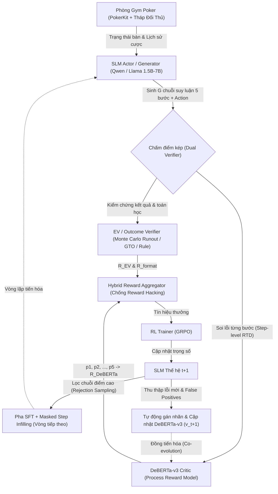

# Pocket-R1: Phòng Gym Tự Tiến Hóa cho SLM trong Miền Poker (*High Risk – High Reward*)

> **Mục tiêu:** Xây dựng phòng thí nghiệm tự tiến hóa huấn luyện Small Language Model (SLM) làm chủ tư duy chiến thuật Poker thông qua vòng lặp **SFT + DeBERTa-v3 Step-level PRM + RL (GRPO)**.

---

## 1. Tầm nhìn & Động lực (Vision & Motivation)

`pocket-r1` không đi theo lối mòn finetune SLM truyền thống (tải một tập dữ liệu tĩnh rồi chạy LoRA SFT), mà xây dựng một **hệ thống thí nghiệm tự tiến hóa (Self-Evolving AI Gym)** — nơi giao thoa của nhiều kỹ thuật AI cốt lõi:

* **Decoder SLM (Actor / Generator):** Tự thực hành, suy luận chiến thuật theo từng bước bằng ngôn ngữ tự nhiên (Chain-of-Thought) và ra quyết định.
* **Encoder DeBERTa-v3 (Critic / Step-level PRM):** Tận dụng sức mạnh nhìn 2 chiều và bản năng phát hiện lỗi (*Replaced Token Detection – RTD*) làm **"Huấn luyện viên soi lỗi từng bước" (Leak Finder)** siêu nhẹ, không tốn chi phí API LLM.
* **Phòng Gym Verifiable (Poker Engine):** Môi trường tương tác có luật chặt chẽ, đánh giá được kỳ vọng toán học (**Expected Value – EV**) và tạo được hệ thống đối thủ đa dạng.
* **Vòng lặp Huấn luyện Tiến hóa (Iterative SFT → DeBERTa PRM → RL/GRPO):** Lặp đi lặp lại nhiều thế hệ để cả SLM (người chơi) và DeBERTa-v3 (trọng tài) cùng nhau tiến hóa (**Adversarial Co-evolution**).

### Tại sao chọn Poker?

Khác với toán học hay cờ vua (thông tin đầy đủ, tất định), **Poker** là phòng thí nghiệm kinh điển cho bài toán **ra quyết định dưới sự bất định (Imperfect Information & High Risk – High Reward)**, mang giá trị tham chiếu trực tiếp sang các miền thực tế như *Trading, Đấu thầu, Đàm phán và Quản trị rủi ro*:

1. **Minh bạch hóa suy luận (Explainable Decision-Making):** Khác với các bot Poker truyền thống kiểu hộp đen, SLM có thể giải thích rõ ràng lý do *Fold / Call / Raise* (vị trí, bài, Pot Odds, Hand Range đối thủ).
2. **Giải quyết bài toán Phương sai cao (High Variance / Bad Beat) trong RL:** Trong Poker, nước đi đúng (+EV) vẫn có thể thua ván bài do lá River may rủi. Sự kết hợp giữa **EV Reward** và **DeBERTa-v3 PRM** giải quyết tận gốc tình trạng nhiễu thưởng (*Result-Oriented Bias*) khiến RL thông thường khó hội tụ.

---

## 2. Kiến trúc Tổng thể Hệ thống



---

## 3. Chi tiết các Thành phần Cốt lõi

### 3.1. Phòng Gym Poker & Tháp Đấu Trường (Curriculum & League)

Để bài toán vừa sâu sắc về chiến thuật vừa khả thi về tài nguyên tính toán, phòng Gym được thiết kế theo lộ trình tăng dần độ khó:

* **Thu gọn không gian hợp lý (Scope):**
  * *Giai đoạn Prototype (kiểm thông pipeline):* **Leduc Poker** (luật gọn, chạy cực nhanh để debug toàn bộ vòng SFT + DeBERTa + GRPO).
  * *Giai đoạn Chính thức:* **Heads-Up (1v1) No-Limit Texas Hold'em** với **rời rạc hóa hành động (Action Abstraction)** gồm 6 lựa chọn chuẩn: `Fold`, `Check/Call`, `Bet/Raise 0.33x Pot`, `0.75x Pot`, `1.5x Pot`, `All-in`.
* **Tháp đối thủ 3 tầng (Arena League):**
  1. **Tầng 1 – Khởi động (Cold-start SFT):** Học từ tập tình huống chuẩn (như *PokerBench* hoặc dữ liệu sinh từ solver/rule) để SLM hiểu luật, nắm định dạng suy luận và đạt năng lực nền (tránh hiện tượng *Zero-Reward* khi mới vào RL).
  2. **Tầng 2 – Dàn Bot đa tính cách (Exploitative Training):**
     * *Calling Station* (rất hay theo bài) → ép SLM học **Value Bet**, hạn chế Bluff bừa.
     * *Nit / Tight* (chỉ chơi bài cực mạnh) → ép SLM học **cướp Pot / Bluff có tính toán**.
     * *Maniac / Aggressive* (hay tố mạnh hù dọa) → ép SLM học **gài bẫy / Bluff-catch**.
     * *TAG (Tight-Aggressive)* → đối thủ cân bằng, khó chịu.
  3. **Tầng 3 – GTO Bot & League Play:** Đấu với Bot dựa trên Equity/CFR (`OpenSpiel`) xen kẽ với các phiên bản quá khứ của chính SLM (`SLM_v1`, `SLM_v2`...) để tránh hiện tượng quên chiến thuật khắc chế lối đánh cũ.

---

### 3.2. Định dạng Chuỗi Suy luận của SLM (Structured Poker CoT)

Mọi output của SLM trong Gym được chuẩn hóa thành **5 bước tường minh** (ngắn gọn dưới `1024 tokens` để nằm đúng vùng tối ưu của DeBERTa-v3):

```text
<step>1. Tình huống: Vị trí BTN, Stack 95BB, bài tẩy A♠ K♠, mặt bàn Q♠ 7♠ 2♥ (Pot 12BB).</step>
<step>2. Sức mạnh bài: Hiện có Ace-high kết hợp Nut Flush Draw (9 lá cơ hội mua thùng) và 2 overcards.</step>
<step>3. Toán học: Đối thủ bet 6BB vào pot 12BB → Pot Odds cần thiết = 6 / (12 + 6 + 6) = 25%. Equity ước tính ~45% > 25%.</step>
<step>4. Đọc vị: Đối thủ có xu hướng bet mạnh trên mặt khô, có thể cầm cặp Q hoặc bài mua bán yếu hơn.</step>
<step>5. Quyết định: Có đủ equity và ưu thế vị trí, có thể Call lấy lá Turn hoặc Raise semi-bluff.</step>
<action>CALL</action>
```

---

### 3.3. Giám khảo Soi lỗi từng bước: DeBERTa-v3 (PRM / RTD Critic)

#### Tại sao chọn DeBERTa-v3?

* **Nhìn 2 chiều (Bidirectional Attention):** Khi chấm Bước 3, DeBERTa đọc được cả đề bài + Bước 1–2 (phía trước) lẫn Bước 4–5 + Action (phía sau) để phát hiện ngay mâu thuẫn logic.
* **Bản năng "bắt lỗi" từ RTD Pretraining:** Vốn được huấn luyện bằng bài toán *Replaced Token Detection*, cực nhạy với các chi tiết sai lệch hoặc bịa đặt (*hallucination*).
* **Siêu nhẹ & miễn phí trong RL:** Bản `deberta-v3-base` (~184M tham số) hoặc `large` (~435M tham số) chỉ chiếm ~1–2GB VRAM, chấm hàng trăm chuỗi/giây tại chỗ.

#### Thiết kế kiến trúc chấm điểm

* **Mức ưu tiên (Step-level PRM):** Chèn token đặc biệt `[STEP]` vào cuối mỗi bước của chuỗi suy luận rồi đưa qua DeBERTa-v3:
  ```text
  [CLS] Trạng thái bàn [SEP] Bước 1 [STEP] Bước 2 [STEP] ... Bước 5 + Action [STEP] [SEP]
                                       ↓             ↓                         ↓
                                   p_1 = 0.96    p_2 = 0.14 (Lỗi!)         p_5 = 0.20
  ```
* Lấy hidden state tại các vị trí `[STEP]` qua lớp `Linear → Sigmoid` để dự đoán xác suất đúng $p_k \in [0, 1]$.
* **Lợi ích quan trọng:** Chấm ở cấp độ *Step* giải quyết triệt để vấn đề **lệch Tokenizer** giữa SLM (Qwen/Llama) và DeBERTa-v3 (SentencePiece).
* **Chống chấm điểm cực đoan (Calibration):** Áp dụng **Label Smoothing** (nhãn `0.05` / `0.95`) hoặc huấn luyện hồi quy trên điểm liên tục để tín hiệu reward mượt mà hơn cho RL.

#### Các lỗi điển hình DeBERTa-v3 sẽ bắt sống

1. **Ảo giác đọc bài:** Nhìn nhầm chất bài/số bài, tưởng tượng ra sảnh/thùng chưa tồn tại.
2. **Sai toán học:** Đếm sai số *outs*, tính sai công thức *Pot Odds*, so sánh ngược *Equity* với *Pot Odds*.
3. **Mâu thuẫn ngữ cảnh:** Đọc sai lịch sử hành động (*Action History*) của đối thủ.
4. **Lập luận một đằng, hành động một nẻo:** Bước 3–4 phân tích bài yếu không đủ odds, nhưng `<action>` lại bấm `ALL_IN`.

#### Cách tự động tạo dữ liệu huấn luyện DeBERTa-v3 (Không cần gán nhãn tay)

1. **Kiểm chứng tự động bằng Code Python:** Dùng `pokerkit` / `eval7` kiểm tra chính xác 100% Bước 1 (bài/stack), Bước 2 (tay bài hiện tại/outs), Bước 3 (Pot Odds & Equity).
2. **Tạo lỗi giả theo đúng tinh thần RTD (Synthetic Corruption):** Lấy chuỗi suy luận đúng, dùng script cố tình **phá hỏng một bước ngẫu nhiên** (đổi chất lá bài, làm sai con số Pot Odds, tráo hành động cuối `FOLD` ↔ `CALL`) để tạo cặp dữ liệu chuẩn dạy DeBERTa bắt lỗi.
3. **Monte Carlo Rollout (kiểu Math-Shepherd) / LLM Distillation:** Đánh giá chất lượng bước chiến thuật bằng xác suất thắng/EV khi chạy tiếp nhiều nhánh, hoặc dùng LLM lớn chấm mẫu một lần duy nhất (2.000–5.000 ví dụ) để chưng cất tri thức soi lỗi vào DeBERTa-v3.

---

### 3.4. Hàm Reward Chống Hack & Cơ chế Đồng tiến hóa

> [!IMPORTANT]
> Tuyệt đối không dùng 100% điểm DeBERTa-v3 để huấn luyện RL, vì SLM sẽ học cách "lừa" trọng tài (*Reward Hacking*) — viết văn phong đẹp mắt để ăn điểm PRM cao nhưng đánh thua sạch chip.

#### Công thức Hybrid Reward

$$
R_{\text{total}} = \alpha \cdot R_{\text{EV}} + \beta \cdot R_{\text{DeBERTa}} + \gamma \cdot R_{\text{format}}

$$

* **$R_{\text{EV}}$ (Trọng số chính, gợi ý $\alpha = 0.6$):** Điểm kỳ vọng toán học (*Expected Value*) của hành động tính qua Monte Carlo runout hoặc đối chiếu GTO/kết quả trung bình — giúp triệt tiêu nhiễu do lá River hên xui.
* **$R_{\text{DeBERTa}}$ (Trọng số quá trình, gợi ý $\beta = 0.3$):** Gộp từ xác suất từng bước của DeBERTa-v3 bằng hàm **Min** ($\min_k p_k$, chỉ cần 1 bước lỗi là kéo cả chuỗi xuống) hoặc **Trung bình nhân** $\left(\prod_{k=1}^T p_k\right)^{1/T}$.
* **$R_{\text{format}}$ (Trọng số cấu trúc, gợi ý $\gamma = 0.1$):** Đảm bảo SLM tuân thủ đúng thẻ `<step>` và `<action>` hợp lệ trong luật Poker.

#### Cơ chế Đồng tiến hóa (Adversarial Co-evolution)

* **Vòng 1:** SLM v1 mắc nhiều lỗi sơ đẳng (đọc nhầm bài, tính sai Pot Odds) → DeBERTa v1 bắt rất tốt → RL sửa triệt để cho SLM v2.
* **Vòng 2+:** SLM v2 thông minh hơn, phát sinh lỗi chiến thuật tinh vi hơn hoặc tìm cách lách luật DeBERTa v1 → Hệ thống tự động thu thập các mẫu **False Positives** (DeBERTa chấm cao nhưng EV thực tế âm nặng) để **finetune nâng cấp DeBERTa v2** → Tiếp tục ép SLM v3 tiến hóa.

---

### 3.5. "Gia vị" Bổ sung: Masked Reasoning / FIM (Tinh thần che-rồi-đoán ngay trên SLM)

Ngoài vai trò RTD của DeBERTa-v3, trong pha SFT (hoặc xen kẽ giữa các vòng lặp), có thể bổ sung bài tập **Masked Step Infilling**:

* Lấy một chuỗi suy luận đúng 5 bước, **che mất Bước 2 hoặc Bước 3** ở giữa (`<prefix> ... <MASK_STEP> ... <suffix>`).
* Bắt chính SLM dựa vào ngữ cảnh trước và sau để điền lại bước bị che.
* **Tác dụng:** Ép SLM thực sự hiểu mối quan hệ nhân quả giữa các bước thay vì chỉ học sinh chữ theo thói quen từ trái sang phải.

---

## 4. Vòng lặp Thực nghiệm & Thí nghiệm Đối chứng (Ablation Study)

### Quy trình mỗi vòng lặp (Iteration $t$)

1. **Rollout trong Gym:** Cho `SLM` đấu hàng nghìn ván ở tầng đối thủ tương ứng, lưu lại toàn bộ trajectory.
2. **Chấm điểm & Huấn luyện Trọng tài:** Tính EV + kiểm tra lỗi tự động + gom mẫu False Positives → Huấn luyện / Cập nhật `DeBERTa-v3` (kiểm tra riêng chỉ số **F1 / AUC** trước khi đưa vào RL).
3. **Pha SFT (Cold-start / Rejection Sampling):**
   * *Vòng 1:* SFT từ tập dữ liệu khởi động chuẩn (có thể trộn thêm bài tập Masked Step Infilling).
   * *Vòng 2+:* Lọc các trajectory đạt điểm cao nhất (cả EV lẫn PRM) để làm *Rejection Sampling Fine-Tuning (RFT)*. Để tránh *Model Collapse / Catastrophic Forgetting*, nên ưu tiên huấn luyện lại từ Base Model bằng tập dữ liệu tinh tuyển cộng dồn, hoặc chạy RL liên tục với Curriculum tăng độ khó.
4. **Pha RL (GRPO):** Tối ưu chuỗi suy luận của SLM với thuật toán **GRPO** (không cần mạng Critic cồng kềnh, tiết kiệm VRAM, sinh ra cho bài toán reasoning) dùng *Hybrid Reward*.
5. **Đánh giá độc lập:** Chấm trên **Held-out Test Set** (những tình huống & đối thủ không dùng lúc train) để xác nhận model thực sự thông minh lên.

### Thiết kế Bảng Thí nghiệm Đối chứng (Ablation Study)

Để dự án mang tính khoa học cao và dễ debug từng "nguyên liệu", các mô hình sẽ được so sánh song song trên cùng một benchmark:


| Phiên bản Thí nghiệm  | Thành phần bật                                           | Mục tiêu chứng minh                                                                     |
| :-------------------------- | :------------------------------------------------------------ | :------------------------------------------------------------------------------------------- |
| **Exp 0 (Baseline)**      | Base SLM (Zero-shot / Few-shot)                             | Đo mức năng lực gốc và các lỗi sơ đẳng ban đầu.                               |
| **Exp 1 (+ SFT)**         | Base + Cold-start SFT (+ tùy chọn Masked Infilling)       | Đo mức cải thiện về format, luật chơi và toán cơ bản.                           |
| **Exp 2 (RL Cơ bản)**   | SFT + GRPO *(chỉ dùng tiền thắng/thua ván bài)*       | Minh họa rõ tác hại của phương sai cao (*High Variance*).                           |
| **Exp 3 (+ EV Reward)**   | SFT + GRPO *(dùng EV Reward)*                              | Chứng minh EV giúp RL hội tụ ổn định hơn.                                          |
| **Exp 4 (+ DeBERTa PRM)** | SFT + GRPO *(EV + DeBERTa-v3 Step PRM)*                     | Chứng minh trọng tài soi lỗi từng bước giúp giảm hallucination & tăng tốc học. |
| **Exp 5 (Co-evolution)**  | Lặp lại Vòng 2, Vòng 3 *(nâng cấp cả SLM & DeBERTa)* | Chứng minh sức mạnh của vòng lặp tự tiến hóa qua nhiều thế hệ.                 |

---

## 5. Thước đo Thành công & Kịch bản Demo

1. **Hiệu suất thực chiến (`BB/100`):** Số Big Blinds thắng trung bình trên mỗi 100 ván khi đối đầu với từng loại Bot (Calling Station, Nit, Maniac, TAG, GTO Bot).
2. **Chất lượng suy luận (Reasoning Integrity):**
   * Tỷ lệ ảo giác đọc nhầm bài / mặt bàn (*Card Hallucination Rate*).
   * Tỷ lệ tính đúng *Pot Odds* và *Outs*.
   * Độ nhất quán giữa lập luận và hành động cuối (*Logic–Action Consistency*).
3. **Hiệu năng Trọng tài DeBERTa-v3:** Chỉ số `AUC-ROC` và `F1-score` phát hiện đúng bước sai trên tập kiểm thử độc lập.
4. **Kịch bản Demo "David vs. Goliath":** Đưa SLM nhỏ (1.5B–7B) sau khi rèn luyện qua Gym ra đánh đối kháng trực tiếp 500–1.000 ván với một LLM kích thước lớn chưa chuyên hóa, hiển thị trực quan luồng suy luận 5 bước và bảng điểm từng bước do DeBERTa-v3 chấm.

---

## 6. Tech Stack Đề xuất & Lộ trình Triển khai

### Tech Stack


| Hạng mục                 | Công cụ gợi ý                                                                                  |
| :--------------------------- | :--------------------------------------------------------------------------------------------------- |
| **SLM Base (Actor)**       | `Qwen2.5` / `Qwen3` (`1.5B`, `3B`, `4B`, hoặc `7B`) hoặc `Llama-3.2-3B`                          |
| **Critic / PRM**           | `microsoft/deberta-v3-base` (~184M) hoặc `deberta-v3-large` (~435M)                               |
| **Poker Gym & Math**       | `PokerKit`, `eval7` / `treys`, `OpenSpiel` (cho CFR/GTO Bot)                                       |
| **Training SFT & RL**      | `Unsloth` hoặc HuggingFace `TRL` (`SFTTrainer` + `GRPOTrainer`), `vLLM` (tăng tốc sinh rollout) |
| **Theo dõi Thí nghiệm** | `Weights & Biases (W&B)` hoặc `MLflow`                                                            |

### Lộ trình 4 Giai đoạn (Từ MVP đến Hoàn thiện)

* **Phase 1 – Xây Phòng Gym & Đấu trường (Tuần 1–2):**
  * Dựng môi trường Poker (`PokerKit`), chuẩn hóa prompt trạng thái bàn & parser đọc `<step>` / `<action>`.
  * Viết 4 Bot tính cách cơ bản + bộ tính EV (Monte Carlo runout) + script kiểm tra lỗi tự động (đọc bài, Pot Odds).
  * Chạy benchmark **Exp 0 (Base SLM)** để lấy số liệu gốc.
* **Phase 2 – Cold-start SFT & Baseline (Tuần 3):**
  * Chuẩn bị dữ liệu SFT (kết hợp *PokerBench* / tình huống tự sinh kèm CoT 5 bước, thử nghiệm thêm *Masked Step Infilling*).
  * Train **Exp 1 (SFT)** và xác nhận độ chính xác format + năng lực nền đạt ngưỡng ổn định trước khi vào RL.
* **Phase 3 – Huấn luyện DeBERTa-v3 Leak Finder (Tuần 4):**
  * Sinh tập dữ liệu đúng/sai theo từng bước (kết hợp Code Verifier + Synthetic Corruption kiểu RTD).
  * Train `DeBERTa-v3` Step-level PRM, hiệu chỉnh *Label Smoothing* và đạt `F1 / AUC` cao trên tập validation.
* **Phase 4 – Vòng lặp GRPO, Co-evolution & Ablation Study (Tuần 5–6+):**
  * Chạy **Exp 2 → Exp 3 → Exp 4** để so sánh trực tiếp hiệu quả của *EV Reward* và *DeBERTa-v3 PRM*.
  * Thực hiện vòng lặp nâng cấp cả DeBERTa-v3 lẫn SLM (**Exp 5**), mở rộng sang *League Play*.
  * Tổ chức trận Showmatch, vẽ biểu đồ phân tích và đóng gói báo cáo/demo.

---

## 7. Tóm tắt Rủi ro Chính & Cách Phòng tránh


| Rủi ro                                 | Nguyên nhân                                            | Biện pháp xử lý                                                                                             |
| :---------------------------------------- | :--------------------------------------------------------- | :---------------------------------------------------------------------------------------------------------------- |
| **Nhiễu phương sai (High Variance)** | Chấm RL bằng tiền thắng/thua 1 ván bài may rủi.   | Dùng **EV (Monte Carlo)** kết hợp **DeBERTa PRM**.                                                           |
| **Reward Hacking**                      | SLM học cách viết "nịnh" DeBERTa nhưng đánh thua. | Dùng **Hybrid Reward** (ưu tiên EV) + cập nhật DeBERTa bằng *False Positives*.                            |
| **Cắt cụt Context ở DeBERTa**        | SLM suy luận lan man vượt quá ~1024–1536 tokens.    | Ép khung 5 bước gọn gàng + phạt nhẹ độ dài trong $R_{\text{format}}$.                                 |
| **Model / Entropy Collapse**            | Lặp SFT mù quáng lên chính output tự sinh.         | Dùng *Rejection Sampling* chuẩn, train lại từ Base hoặc tăng độ khó đối thủ theo Curriculum.        |
| **Trọng tài chấm sai**               | DeBERTa-v3 chưa đủ giỏi đã thả vào vòng RL.     | Luôn đặt cổng kiểm duyệt chất lượng (chỉ đưa vào RL khi `AUC / F1` trên tập Val đạt ngưỡng). |
